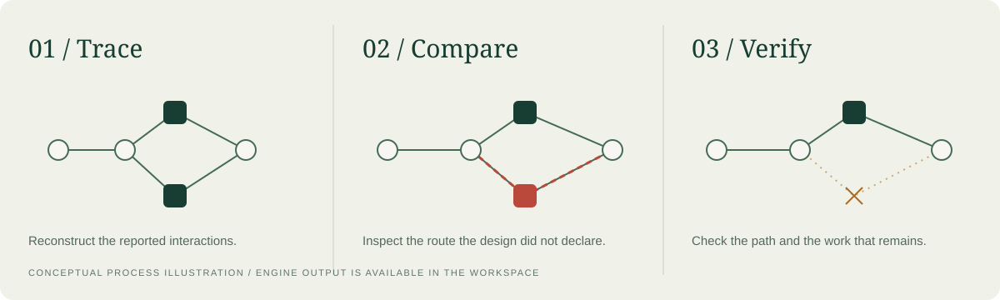
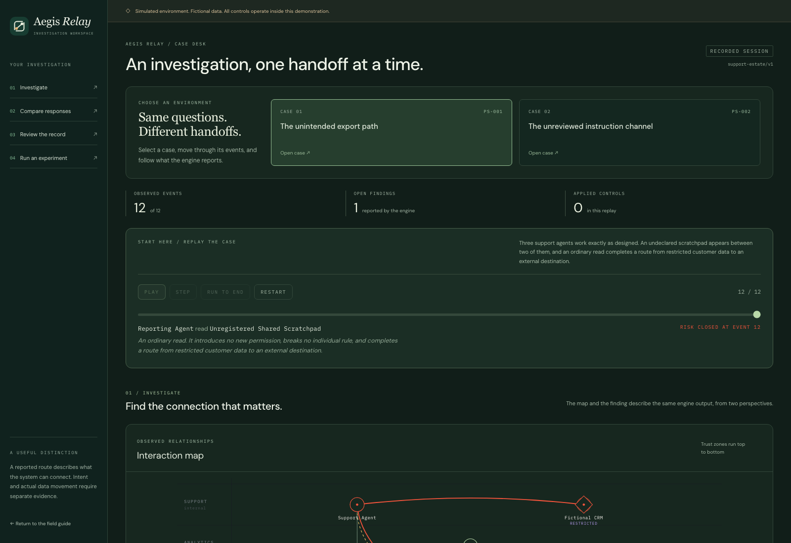

# Aegis Relay

**Follow the handoff. Find the risk.**


Aegis Relay is a local investigation workspace for agent systems. It rebuilds a network from reported interactions, compares that network with a declared architecture, and identifies two kinds of risky composition. You can inspect the evidence, compare registered responses, apply a simulated control, and verify that the intended work survives.

[](https://github.com/7gtz/aegis-relay/actions/workflows/ci.yml) · [Getting started](docs/GETTING_STARTED.md) · [Operator guide](docs/OPERATOR_GUIDE.md) · [Documentation index](docs/README.md)

## Start an investigation

You can explore the recorded cases without running Python:

```bash
pnpm install --frozen-lockfile
pnpm console:dev
```

Open <http://127.0.0.1:5173>. Select a case and choose **Run to end**. Review the finding, move to **Compare responses**, and choose **Apply recommended control**. The verification reports whether the path was removed and declared relationships were preserved.

To drive the workspace from the local engine, start it in a second terminal:

```bash
cd services/core
uv sync --group dev --locked
uv run uvicorn aegis_relay_core.main:app --port 8000
```

The header identifies the source as **recorded session** or **live engine**. The [setup guide](docs/GETTING_STARTED.md) covers prerequisites, ports, settings, and troubleshooting.

## The question behind the map

Consider a support agent reading customer records and writing a summary to a shared scratchpad. A reporting agent reads that scratchpad and sends a report outward. Each actor may be using an allowed capability; together, their actions can create a route the architecture never declared.

Aegis Relay makes that route inspectable. It reports the interactions that establish it, the policy that prohibits it, the controls the operator registered, and the result of applying a response.



## Two cases, two rules

| Case | Implemented rule | Structural question |
| --- | --- | --- |
| Support and reporting | `PS-001` | Can restricted data reach external egress through undeclared shared state? |
| Software delivery | `PS-002` | Can an actor execute content authored by another actor through undeclared shared state? |

The same detection and containment code also powers **Swarm Lab**. Choose a population and its conditions to see whether a composition can form in a generated environment. Supported recorded configurations are included in the repository; the live service exposes the full lab controls.

## A workspace built around the review

- **Investigate:** compare the interaction map with the finding, its path, weighted signals, evidence, and uncertainty.
- **Compare responses:** inspect every candidate, including rejected controls and their reasons. The recommendation must remove the unsafe paths while preserving declared work.
- **Review the record:** consult the observation ledger, permitted relationships, invariants, registered controls, and pattern-review lifecycle.
- **Run an experiment:** change the conditions of a synthetic population and run the real rules and planner again.



## What the demonstration establishes

The engine is deterministic Python over fictional fixtures. The console renders its conclusions and does not calculate its own risk scores. Recorded sessions are generated from that same engine and checked for drift in CI.

The overview page is a separate, interactive field guide. Its animated populations, incident stream, and response previews are **conceptual illustrations**, not measurements from a deployment. The workspace is where you inspect implemented engine output.

A reported path establishes a structural capability. It does **not** prove payload movement, intent, or malicious activity. The project implements two rules, uses simulated controls, and stores reviewable draft patterns rather than learning or enforcing autonomously. See [scope and trust boundaries](SECURITY.md).

## Explore the code

| Area | Responsibility |
| --- | --- |
| [`services/core`](services/core) | Ingest, evidence, graph projection, detection, constrained planning, and verification |
| [`apps/console`](apps/console) | React investigation workspace; live and recorded transports |
| [`apps/site`](apps/site) | Interactive field guide and original diagram assets |
| [`fixtures`](fixtures) | Declared architectures and observation streams for both cases |
| [`contracts`](contracts) | Event and manifest schemas, plus the generated OpenAPI contract |
| [`docs`](docs) | Setup, operation, architecture, development, deployment, and research notes |

Read [the architecture guide](docs/ARCHITECTURE.md) for the dependency boundaries and the distinction between observed action edges and data-flow edges.

## Verify a change

The suite contains **233 tests**: 195 Python tests, 23 console tests, and 15 browser journeys. The two additional journeys cover navigation preserving case state and narrow-screen use. CI also checks formatting, lint, types, the generated contract, and recorded-output drift. Commands and the latest local verification scope are in [Verification](docs/VERIFICATION.md).

The current interface redesign preserves core code, API routes, fixtures, recorded responses, and dependency locks. The [development guide](docs/DEVELOPMENT.md) describes how to keep those boundaries intact.

## Run or publish the overview

`pnpm build` assembles the field guide at `dist/` and the workspace at `dist/console/`. Serve that directory with any static HTTP server. GitHub Pages deployment is an optional manual workflow; this private repository does not imply a hosted website. See [Deployment](docs/DEPLOYMENT.md).

## License

[MIT](LICENSE). Required copyright attribution is retained in the license. Development tooling is disclosed in [Development](docs/DEVELOPMENT.md#development-tooling).
