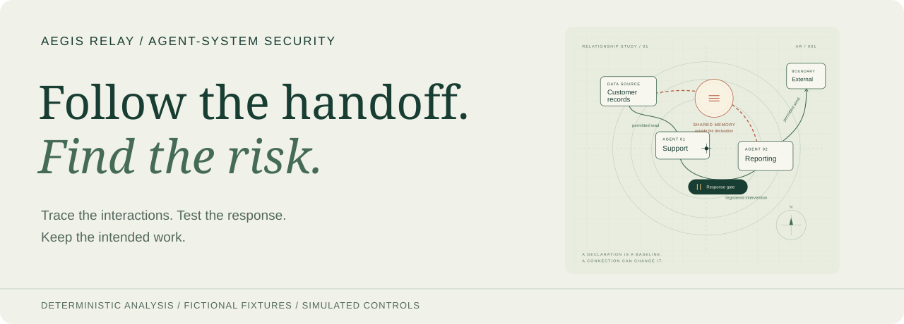
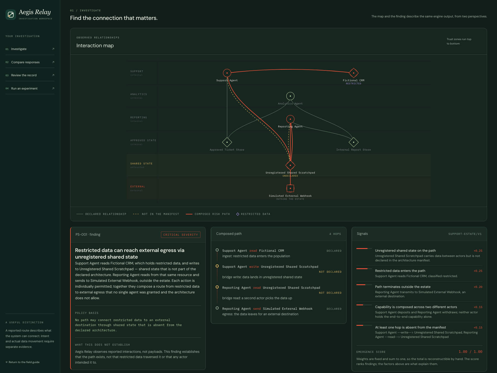
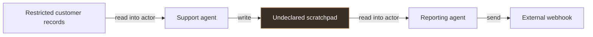
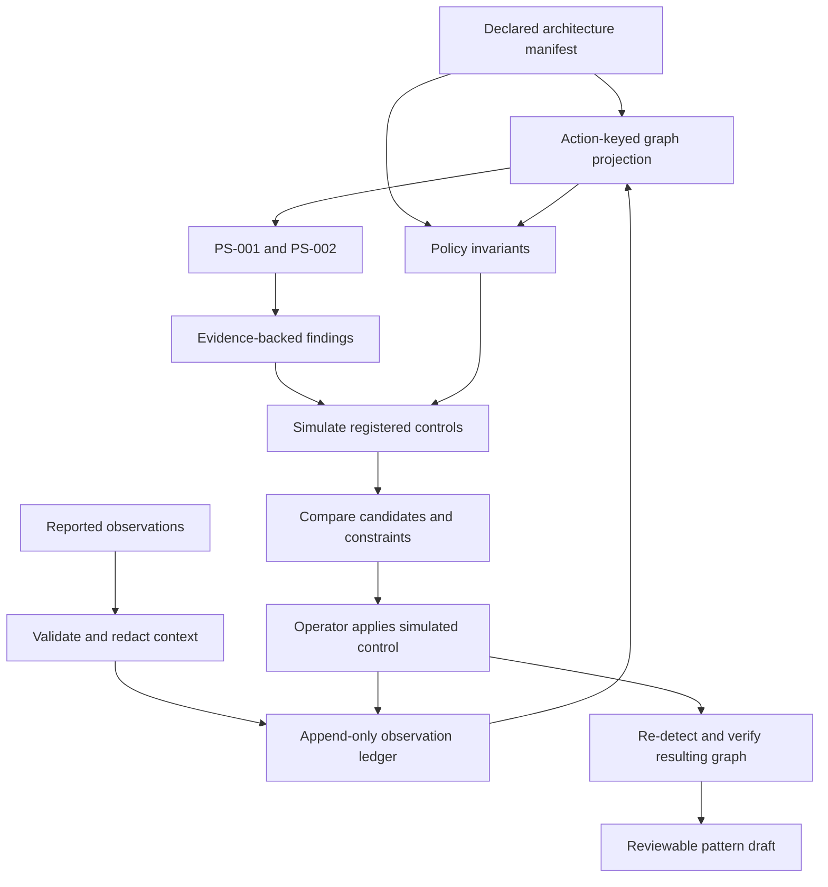
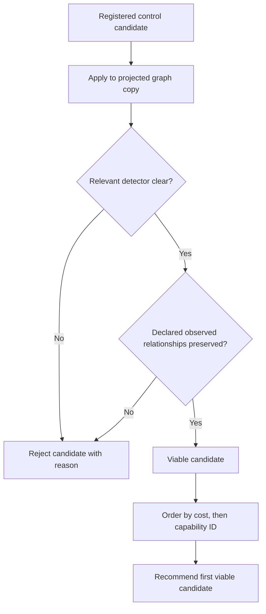
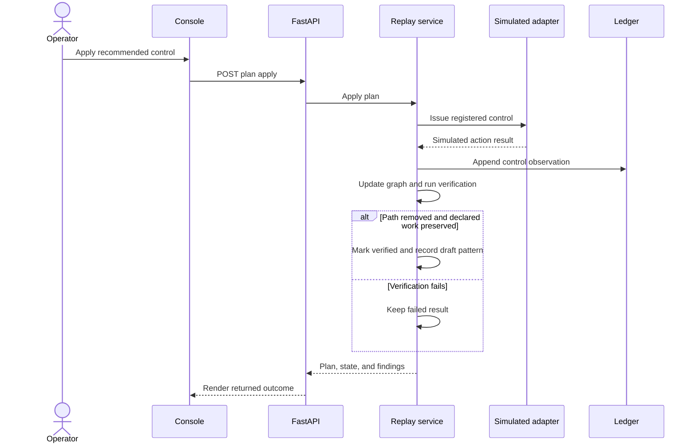
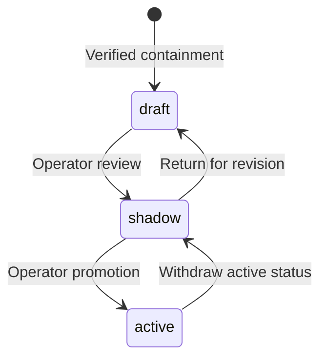
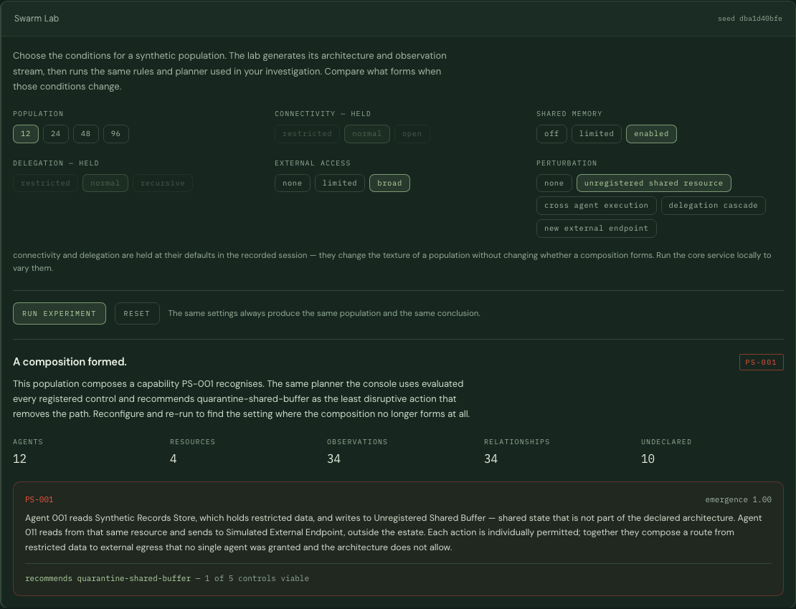
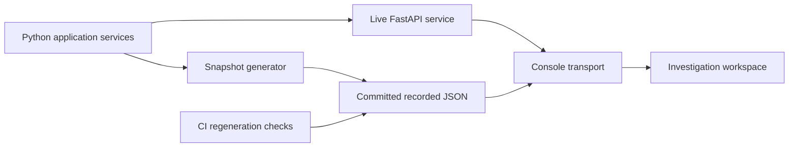
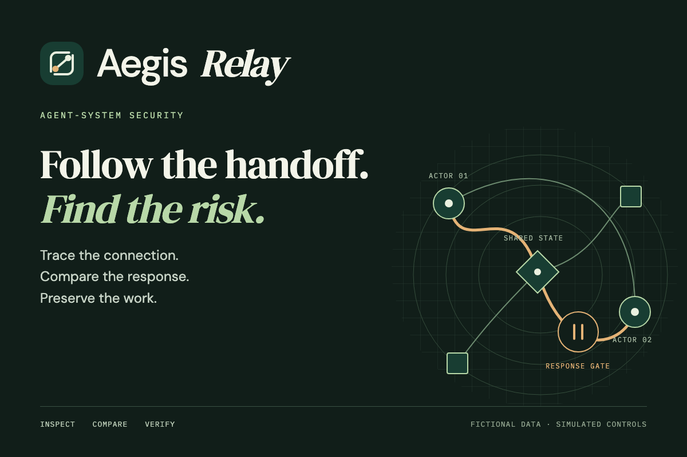

# Aegis Relay

**Follow the handoff. Find the risk.**



Aegis Relay is an investigation workspace for security risks that emerge across agent interactions. It reconstructs reported activity, compares it with a declared architecture, and identifies structural capabilities that individual permissions can miss. Operators can trace the evidence, compare constrained responses, apply a simulated control, and verify whether the risky composition disappeared without breaking declared work.

[](https://github.com/7gtz/aegis-relay/actions/workflows/ci.yml)
[](LICENSE)
[](services/core/pyproject.toml)
[](package.json)

[**Open the demo**](https://aegis-relay-six.vercel.app/) · [**Launch the workspace**](https://aegis-relay-six.vercel.app/console/) · [**Watch the demo video**](https://youtu.be/dDKlWDBkJ_8) · [Quick start](#quick-start) · [Investigation walkthrough](#work-a-case) · [Architecture](#how-the-engine-works) · [API](#http-api) · [Handbook](docs/README.md) · [Devpost kit](docs/submission/README.md) · [Changelog](CHANGELOG.md)

## What you can do

| Investigate | Compare | Verify | Experiment |
| --- | --- | --- | --- |
| Replay observations and inspect the path, evidence, policy basis, weighted signals, and uncertainty. | Review every registered response, including rejected candidates and the relationships they would break. | Apply a simulated response and independently check the resulting graph. | Generate populations in Swarm Lab and run the same detection and planning pipeline. |

The runtime is deterministic Python: no model-provider account, inference call, or API key is needed. The React console presents engine output; it does not calculate a separate security assessment. A recorded transport makes the demonstration usable without a running backend.



<details>
<summary><strong>Contents</strong></summary>

- [Why inspect the handoff?](#why-inspect-the-handoff)
- [Quick start](#quick-start)
- [Work a case](#work-a-case)
- [How the engine works](#how-the-engine-works)
- [Implemented detection rules](#implemented-detection-rules)
- [Response planning and verification](#response-planning-and-verification)
- [Reviewed patterns](#reviewed-patterns)
- [Swarm Lab](#swarm-lab)
- [Recorded and live modes](#recorded-and-live-modes)
- [HTTP API](#http-api)
- [Repository map](#repository-map)
- [Build and deployment](#build-and-deployment)
- [Verification and reproducibility](#verification-and-reproducibility)
- [Scope and trust boundaries](#scope-and-trust-boundaries)
- [Documentation and contributions](#documentation-and-contributions)

</details>

## Why inspect the handoff?

A support agent can read customer records and write a summary. A reporting agent can read shared state and send a report outward. Those capabilities can combine into an undeclared route from restricted records to an external destination, even when each action appears routine in isolation.

The support fixture contains this data-flow shape:



These arrows describe potential **data flow**. An observed read is stored as `actor → resource`; its data-flow orientation is `resource → actor`. Writes and sends retain their direction. Confusing these views can hide the composed route.

Aegis Relay reports the structural path and the observations supporting it. A path is evidence of capability; it does not establish that a payload traversed the path or that an actor intended harm.

## Quick start

### Requirements

| Tool | Version | Needed for |
| --- | --- | --- |
| Node.js | 22.x, at least 22.16.0 | Console and static field guide |
| pnpm | 11.19.x; pinned to 11.19.0 | Workspace installation and builds |
| Python | 3.12 | Live analysis service and core checks |
| uv | CI pins 0.7.8 | Locked Python environment |

Version declarations live in [.nvmrc](.nvmrc), [.python-version](.python-version), [package.json](package.json), and [pyproject.toml](services/core/pyproject.toml).

### Explore the recorded workspace

```bash
git clone https://github.com/7gtz/aegis-relay.git
cd aegis-relay
pnpm install --frozen-lockfile
pnpm console:dev
```

Open <http://127.0.0.1:5173>. The repository is private, so cloning requires an account with access. Select a case and choose **Run to end**. When the local service is unavailable, the header identifies the source as **recorded session**.

### Connect the live engine

In another terminal, from the repository root:

```bash
cd services/core
uv sync --group dev --locked
uv run uvicorn aegis_relay_core.main:app --host 127.0.0.1 --port 8000
```

Reload the console and check for **live engine** in the header. Open <http://127.0.0.1:8000/docs> for the interactive API reference or <http://127.0.0.1:8000/api/v1/health> for operating-mode metadata.

| Setting | Purpose |
| --- | --- |
| `VITE_AEGIS_RELAY_API_BASE` | Console API URL, read at Vite startup/build; defaults to `http://127.0.0.1:8000`. |
| `AEGIS_RELAY_CORS_ORIGINS` | Comma-separated allowed service origins, replacing the local defaults. |

Keep local `.env` files untracked. The [setup guide](docs/GETTING_STARTED.md) explains connection failures, strict development ports, and disabled recorded-mode controls.

## Work a case

1. **Choose the environment.** Use the support/reporting case for a restricted-data route or the software-delivery case for a cross-actor execution channel.
2. **Advance the replay.** Play, step, select a replay position, or run to the end. In the support fixture, position 11 has a deviation without the completed route; position 12 supplies the connecting read.
3. **Investigate.** Read the finding alongside the interaction map, composed path, weighted factors, policy basis, and uncertainty. Follow its evidence references into the observation ledger.
4. **Compare responses.** Inspect costs and both constraints. A response that removes the risky path can still be rejected because it breaks declared relationships.
5. **Apply the recommendation.** The adapter simulates the control and appends a control observation. Verification checks the resulting state.
6. **Review both outcomes.** Confirm **Composed path removed** and **Declared work preserved**. A failed check remains a failed result.
7. **Review the pattern.** Successful containment produces a draft pattern that can be explicitly reviewed through the lifecycle below.

Chapter navigation scrolls within the same mounted workspace, preserving the current case and experiment. Selecting another case resets that case's replay. Live replay state is shared per scenario within one service process; use one operator session when reproducing a sequence.

## How the engine works



**Declaration.** A manifest provides nodes, zones, permitted relationships, invariants, and pre-authorised control capabilities. The baseline is authored input rather than a policy learned from traffic.

**Evidence.** Ingest validates observations and removes context keys that could carry payloads or credentials. The ledger is the observation record; the graph is a rebuildable projection. Conclusions depend on the completeness and correctness of reported activity and the manifest.

**Projection.** A NetworkX `MultiDiGraph` distinguishes actions between the same pair of nodes. A read, write, and discovery remain separate relationships. A control blocking one action need not erase another action between those nodes.

**Application boundary.** Application services coordinate the replay, detector, planner, adapter, verification, and pattern registry. FastAPI transports those results. The domain layer does not depend on the web or presentation frameworks.

**Presentation.** The console renders the engine's state. The separate field guide contains conceptual interactive diagrams and simulations; those teaching aids are not deployment measurements.

See [Architecture](docs/ARCHITECTURE.md) for module ownership and projection details.

## Implemented detection rules

| Rule | Required structural shape | Context surfaced to the operator |
| --- | --- | --- |
| `PS-001` | A restricted-source ingest, deposit into an unregistered resource, withdrawal from that resource, and egress to an external destination. | Unregistered bridge, restricted source, external reachability, cross-actor composition, and undeclared hops. |
| `PS-002` | An actor executes a resource authored by a different actor, with the authoring or execution relationship absent from the declaration. | Cross-actor execution, undeclared channel, shared-state channel, and any observed untrusted upstream input. |

For PS-001, distinct depositing and withdrawing actors contribute a weighted factor; the implementation does not use that distinction as a mandatory gate. For PS-002, untrusted upstream input raises the score but is not required for an internal undeclared execution channel. A channel whose authoring and execution relationships are both declared does not trigger PS-002.

Discovery alone is a precursor, not an ingest relationship. The detectors use deterministic ordering when selecting a qualifying path. Each currently returns at most one finding per projection, so the displayed path should not be read as an exhaustive enumeration of every possible route.

### Reading the score

The emergence score is the sum of the weights of present factors, rounded to three decimals. The factors and their weights remain inspectable. It is a rule-based ranking, not a calibrated probability of compromise.

| Score | Severity |
| --- | --- |
| At least 0.85 | Critical |
| At least 0.60, below 0.85 | High |
| At least 0.35, below 0.60 | Medium |
| Below 0.35 | Low |

The source of truth is [detection/base.py](services/core/src/aegis_relay_core/detection/base.py), [ps001.py](services/core/src/aegis_relay_core/detection/ps001.py), and [ps002.py](services/core/src/aegis_relay_core/detection/ps002.py).

## Response planning and verification

The planner evaluates only control capabilities registered in the manifest. It simulates each candidate, checks the relevant detector again, and compares the declared relationships observed in the current state before and after the change.



Costs are manifest-defined ordering values, not financial estimates. The preservation check covers the observed declared relationships in the replay state; it is not a proof of every possible future workflow.

The support fixture makes the trade-off concrete:

| Registered capability | Cost | Result |
| --- | ---: | --- |
| `block-support-scratchpad-write` | 1 | Viable; recommended |
| `block-reporting-scratchpad-read` | 2 | Viable |
| `quarantine-shared-scratchpad` | 4 | Viable |
| `block-reporting-external-send` | 6 | Rejected; breaks declared work |
| `block-support-crm-read` | 9 | Rejected; breaks declared work |

### Application is checked again



The post-application checks inspect the resulting graph rather than trusting the earlier simulation. An absent viable recommendation does not become an executable control. Reapplying an already applied or verified plan returns its existing result.

## Reviewed patterns

A verified containment can produce an abstracted pattern in the in-memory registry. It begins as a draft; an operator must explicitly request lifecycle changes.



The lifecycle represents reviewed state. It does not add an autonomous learner, deploy a production enforcement integration, or guarantee that the pattern generalises beyond its evidence.

## Swarm Lab

Swarm Lab constructs a synthetic manifest and observation stream from the selected configuration, then runs the same detectors and constrained planner used by the fixture replays. Results include population and graph counts, findings, invariant results, response candidates, and an explanation when the relevant composition does not form.



| Axis | Live API values |
| --- | --- |
| Population | Integer from 3 to 200 |
| Connectivity | `restricted`, `normal`, `open` |
| Shared memory | `off`, `limited`, `enabled` |
| Delegation | `restricted`, `normal`, `recursive` |
| External access | `none`, `limited`, `broad` |
| Perturbation | `none`, `unregistered_shared_resource`, `cross_agent_execution`, `delegation_cascade`, `new_external_endpoint` |

The simulator derives its seed from the configuration, making repeat runs reproducible. Increasing population is not a guarantee of a finding: structural conditions still determine whether a rule fires.

Recorded mode supports populations **12, 24, 48, and 96** and the committed grid of memory, external-access, and perturbation settings. Connectivity and delegation are held at their recorded defaults and visibly disabled. The grid contains **180 lab recordings**, plus two scenario recordings and an index, for **183 JSON files**. Run the live service to use the full API range.

## Recorded and live modes



The client first attempts the configured service and uses recorded output when the service is unavailable. The source badge makes the selected transport visible. The recorded client reproduces the supported replay/control states from generated output; it does not run Python in the browser.

CI regenerates both the OpenAPI contract and recordings and fails on drift. This keeps the static demonstration tied to executable engine output. The field guide's conceptual animations remain a separate presentation layer.

## HTTP API

The API base is `http://127.0.0.1:8000/api/v1`; all routes in the table below are relative to that base. The [committed OpenAPI document](contracts/openapi/aegis-relay-core-v1.json) and the running service's `/docs` are the complete contract.

| Method | Route | Purpose |
| --- | --- | --- |
| GET | `/health` | Liveness and simulation posture |
| GET | `/scenarios` | Available replay cases |
| POST | `/replays/{scenario_id}/reset` | Reset a case |
| POST | `/replays/{scenario_id}/advance?to_sequence=N` | Advance to a position; omit the query to step |
| POST | `/replays/{scenario_id}/run` | Run to the final observation |
| GET | `/replays/{scenario_id}/state` | Current state and graph |
| GET | `/replays/{scenario_id}/findings` | Findings and plans |
| GET | `/replays/{scenario_id}/findings/{finding_id}` | One finding and its plan |
| GET | `/replays/{scenario_id}/evidence?finding_id=...` | Replayed ledger events cited by current findings |
| POST | `/replays/{scenario_id}/plans/{plan_id}/apply` | Apply and verify the recommendation |
| GET | `/replays/{scenario_id}/architecture` | Declaration, invariants, and controls |
| GET | `/replays/{scenario_id}/immunity` | Recorded patterns |
| POST | `/replays/{scenario_id}/immunity/{pattern_id}/promote` | Request lifecycle transition with `{"to":"shadow"}`, for example |
| GET | `/lab/options` | Allowed experiment settings |
| POST | `/lab/simulate` | Generate and analyse a population |

For a reproducible live lab run:

```bash
curl --fail-with-body http://127.0.0.1:8000/api/v1/lab/simulate \
  -H 'Content-Type: application/json' \
  --data '{"population":12,"connectivity":"normal","shared_memory":"enabled","delegation":"normal","external_access":"broad","perturbation":"unregistered_shared_resource"}'
```

State changes use POST routes. GET routes expose results without changing replay position. Replay sessions and pattern records are in memory; restarting the service does not provide durable case storage.

## Repository map

```text
aegis-relay/
├── apps/
│   ├── console/          React workspace, transports, generated recordings
│   └── site/             Interactive field guide, local fonts, vector assets
├── services/core/        Python analysis engine and FastAPI transport
├── fixtures/             Fictional manifests and observation streams
├── contracts/            Event/manifest schemas and generated OpenAPI
├── scripts/              Static-site assembly
├── docs/                 Handbook, screenshots, brand assets, research
└── .github/workflows/    CI and optional manual Pages deployment
```

| Core module | Responsibility |
| --- | --- |
| `domain` | Typed observations, architecture, findings, plans, and patterns |
| `ingest` / `ledger` | Validation, redaction, append-only evidence, replay cursor |
| `graph` | Action-aware observed and data-flow projections |
| `detection` / `policy` | Two implemented rules, weighted signals, invariant witnesses |
| `containment` / `connectors` | Candidate simulation, constraints, simulated control application |
| `immunity` | Explicit pattern-review lifecycle |
| `lab` | Deterministic synthetic populations |
| `application` / `api` | Orchestration and HTTP transport |

The console uses React, TypeScript, Vite, Tailwind CSS, and Zustand. The core uses Python, Pydantic, NetworkX, and FastAPI. Dependencies are locked with pnpm and uv.

## Build and deployment

```bash
pnpm install --frozen-lockfile
pnpm build
python3 -m http.server 8080 --bind 127.0.0.1 --directory dist
```

The assembled artifact serves the field guide at `/` and the recorded workspace at `/console/`. Local fonts and relative asset paths are included. Always serve it over HTTP rather than opening the HTML directly.

The [deployment guide](docs/DEPLOYMENT.md) covers Vercel settings, optional GitHub Pages, and connecting a separately hosted engine. The static demonstration does not deploy the Python API. Its recorded cases and supported experiments work without backend credentials.

## Verification and reproducibility

The suite contains **244 tests**: **195 Python**, **30 console**, **17 browser journeys**, and **2 static-assembly tests**. CI also checks formatting, lint, types, local documentation links, JSON syntax, contract drift, and recorded-output drift. The [verification record](docs/VERIFICATION.md) distinguishes completed checks from the project's broader scope.

```bash
# Repository root
pnpm repo:check
pnpm console:check
pnpm build
pnpm console:e2e

# services/core
uv sync --group dev --locked
uv run ruff format --check src tests
uv run ruff check src tests
uv run mypy
uv run pytest -q
uv run python -m aegis_relay_core.contract
uv run python -m aegis_relay_core.snapshot
```

The [dependency review](docs/DEPENDENCIES.md) records the applied tooling fixes, clean production audit, and remaining moderate development-only advisory.

Inspect generated contract and recording diffs before committing them. Browser journeys exercise the recorded transport without a live service and cover the full investigation/control/review flow, navigation state, and narrow-screen use.

## Scope and trust boundaries

- **Fictional, local analysis.** Fixtures and lab populations are synthetic. The service reports simulated enforcement and no real data or network egress.
- **Reported topology.** Missing observations or an incorrect declaration can change conclusions. The engine does not inspect payloads or infer intent.
- **Two implemented rules.** A clear replay position means those rules did not report a finding; it is not a general security certification.
- **Simulated controls.** Responses modify the demonstrated graph through simulated adapters. Production enforcement connectors are outside this implementation.
- **Bounded verification.** Path removal and preservation are checked against the represented state and rule set, not every future execution.
- **Local service assumptions.** The demonstration includes neither authentication for a public analysis API nor durable multi-tenant case storage.

Read [SECURITY.md](SECURITY.md) for the security model and reporting guidance. Research references are collected in [Research](docs/RESEARCH.md); citations do not imply endorsement or an implemented integration.

## Submission assets

The [Devpost submission kit](docs/submission/README.md) includes a 3:2 thumbnail, a widescreen cover, a social card, a transparent logo export, gallery captions, draft project story, and a two-minute demo script. Editable HTML/SVG source and `pnpm submission:assets` make the brand exports reproducible.



## Documentation and contributions

| Guide | Read it for |
| --- | --- |
| [Getting started](docs/GETTING_STARTED.md) | Versions, launch commands, connection settings, troubleshooting |
| [Operator guide](docs/OPERATOR_GUIDE.md) | Replay, evidence, responses, record review, experiments |
| [Architecture](docs/ARCHITECTURE.md) | Domain boundaries, projections, detection and planning |
| [Development](docs/DEVELOPMENT.md) | Frontend structure, checks, contribution boundaries, tooling disclosure |
| [Deployment](docs/DEPLOYMENT.md) | Static hosting and optional live engine connection |
| [Verification](docs/VERIFICATION.md) | Executable evidence and current limitations |
| [Research](docs/RESEARCH.md) | Background and related work |
| [Submission kit](docs/submission/README.md) | Devpost artwork, gallery, copy, and demo script |

Keep security decisions in the core and preserve the distinction between engine output and conceptual illustrations. A change to detection or control semantics needs a test of the affected guarantee. An interface change should keep the operator's evidence and failed outcomes visible. See [CONTRIBUTING.md](CONTRIBUTING.md) before opening a change.

## License

[MIT](LICENSE). Required copyright attribution is retained. AI-assisted development tooling is disclosed in [Development](docs/DEVELOPMENT.md#development-tooling).
