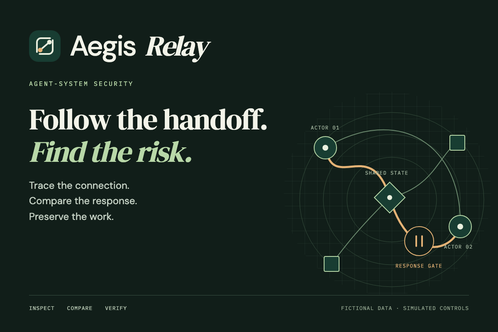

# Devpost submission kit

A pull-ready set of artwork, product screenshots, copy, and a short demo walkthrough. Start with the thumbnail and project story; all images are PNG files ready for upload.



## Upload assets

| File | Dimensions | Suggested use |
| --- | --- | --- |
| [thumbnail.png](assets/thumbnail.png) | 1200 × 800, 3:2 | Devpost project-gallery thumbnail |
| [cover.png](assets/cover.png) | 1920 × 1080, 16:9 | Video title frame or presentation cover |
| [social-card.png](assets/social-card.png) | 1200 × 630 | Social announcement or link preview artwork |
| [mark.png](assets/mark.png) | 1024 × 1024, transparent canvas | Project avatar or logo overlay |
| [Investigation workspace](../assets/working-prototype.png) | 1800 × 1350 | Gallery: map, finding, composed path, weighted signals |
| [Verified response](assets/response-verification.png) | 1310 × 692 | Gallery: candidate comparison and post-control verification |
| [Swarm Lab](../assets/swarm-lab-result.png) | 1110 × 849 | Gallery: generated population and implemented result |

Devpost.com's [submission guide](https://help.devpost.com/article/126-know-your-submission-steps) recommends a 3:2 gallery thumbnail and accepts JPG, PNG, or GIF up to 5 MB. The thumbnail here is under that limit. Event-specific requirements may add fields or video constraints.

The artwork uses the project's existing relay-frame identity, forest palette, bundled fonts, and an editable conceptual route illustration. It does not present invented product measurements. Product screenshots capture the running recorded workspace and real engine-generated results. All assets are covered by the repository's [license](../../LICENSE); bundled font licenses remain with their font files.

## Submission material

- [Project story and built-with tags](PROJECT_STORY.md)
- [Two-minute demonstration script](DEMO_SCRIPT.md)
- [Gallery captions and alt text](GALLERY.md)
- [Verification record](../VERIFICATION.md)

**Demo:** [Field guide](https://aegis-relay-six.vercel.app/) · [Workspace](https://aegis-relay-six.vercel.app/console/)

**Source:** [7gtz/aegis-relay](https://github.com/7gtz/aegis-relay), private. Judges need repository access if source review is required; the public recorded demo needs no login.

The story is ready to adapt to the target hackathon. Add the actual team credits, event-specific answers, and final video link. It makes no claims about when the project was created, sponsor usage, awards, or production adoption.

## Regenerate the artwork

From the repository root, with the pinned Node and pnpm versions:

```bash
pnpm install --frozen-lockfile
pnpm --filter @aegis-relay/console exec playwright install chromium
pnpm submission:assets
```

The exporter serves a temporary loopback HTTP endpoint, waits for bundled fonts, exports four exact-size images, and closes its server and browser. Edit [artwork.html](artwork.html) for thumbnail, cover, and social-card composition; edit [mark.html](mark.html) for the mark export. The relay-frame source is [emblem.svg](../brand/emblem.svg).

The screenshots are product captures, not generated by the artwork exporter. To refresh them, run the workspace, complete the support replay, and capture the investigation. For the lab capture, choose population 12, enabled shared memory, broad external access, and the unregistered shared-resource perturbation, then run the experiment. Keep the source badge and result context honest in any additional captures.
